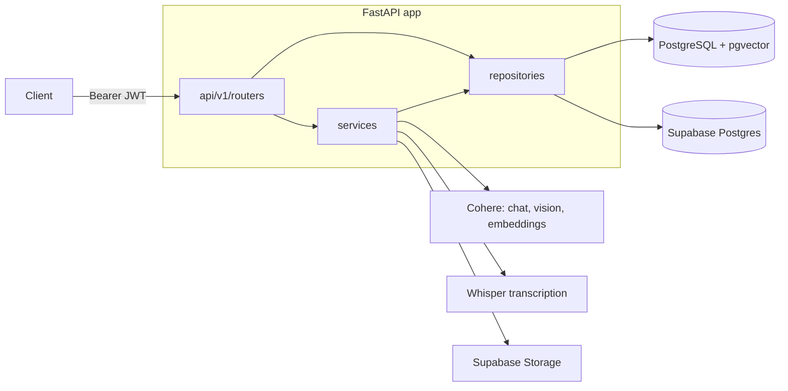

# Multimodal AI Backend

A FastAPI backend that puts an LLM behind a regular REST API: chat with file attachments, image analysis, video transcription with semantic search over the transcript, and text embeddings stored in PostgreSQL with pgvector.

Built as a training project during my AI & Backend internship at Zedny.

## Features

- **Chat with history and files**: messages are stored per chat, the full history is sent to the LLM on each turn, and an uploaded file is stored in Supabase Storage and passed to the model as a document.
- **Image analysis**: upload an image and get a description from a Cohere vision model.
- **Video search**: upload a video, transcribe it with Whisper, split the transcript into timed chunks, summarise and embed each chunk, then search chunks by meaning with pgvector.
- **Embeddings**: embed text with Cohere and compare stored vectors by cosine similarity, Euclidean distance and dot product.
- **Users and items CRUD** with JWT authentication (access and refresh tokens, bcrypt password hashing) and ownership checks.
- **Switchable database mode**: write to a local PostgreSQL, to Supabase, or to both, with a configurable strategy for what happens if the Supabase write fails.

## Architecture



```
App/
├── api/v1/routers/   # HTTP layer: users, items, llm, img, video, embeddings, admin
├── services/         # LLM calls, video pipeline, dual-database logic
├── repositories/     # database queries
├── models/           # SQLAlchemy models (users, items, chats, messages, videos, chunks, embeddings)
├── schemas/          # Pydantic request/response models
├── core/             # settings, JWT helpers, auth dependencies
├── client/           # Supabase Storage client
└── db/               # engines and sessions
tests/                # auth tests
```

## Tech stack

| Area | Tools |
|---|---|
| API | FastAPI, Pydantic, Uvicorn |
| Database | PostgreSQL, pgvector, SQLAlchemy, Supabase |
| AI | Cohere (`command-r-08-2024` chat, `command-a-vision-07-2025` vision, `embed-v4.0` embeddings), OpenAI Whisper |
| Auth | JWT (python-jose), bcrypt (passlib) |
| Storage | Supabase Storage |

## Setup

Requirements: Python 3.10+, PostgreSQL with the [pgvector](https://github.com/pgvector/pgvector) extension, a Cohere API key, a Supabase project, and `ffmpeg` on the PATH (used by Whisper and moviepy).

```bash
git clone https://github.com/moustafasayed068/Ai.git
cd Ai
python -m venv venv
source venv/bin/activate        # Windows: venv\Scripts\activate
pip install -r requirements.txt
cp .env.example .env            # then fill in the values
uvicorn App.main:app --reload
```

Tables are created on startup. Interactive API docs are at `http://localhost:8000/docs`.

### Environment variables

| Variable | Purpose |
|---|---|
| `DATABASE_URL` | Local PostgreSQL connection string |
| `SUPABASE_DB_URL` | Supabase Postgres connection string (needed for `supabase` or `both` mode) |
| `DB_MODE` | `local`, `supabase` or `both` |
| `SUPABASE_FAILURE_STRATEGY` | `fail`, `continue` or `retry` when the Supabase write fails in `both` mode |
| `COHERE_API_KEY` | Cohere API key |
| `SUPABASE_URL`, `SUPABASE_KEY` | Supabase project, used for file storage |
| `SUPABASE_BUCKET` | Bucket for chat files (videos use `video`, images use `images`) |
| `SECRET_KEY` | JWT signing key |
| `ADMIN_EMAILS` | Comma-separated emails allowed to call `/admin` |

## API overview

Everything except creating a user and logging in needs an `Authorization: Bearer <token>` header.

| Method | Path | What it does |
|---|---|---|
| POST | `/users/` | Create a user |
| POST | `/users/login` | Email + password → access and refresh tokens |
| GET | `/users/me` | Current user |
| PUT, DELETE | `/users/{user_id}` | Update or delete your own account |
| POST, GET | `/items/` | Create an item, list your items |
| PUT, DELETE | `/items/{item_id}` | Update or delete your own item |
| POST | `/llm/llm/chat/` | Send a message (optionally with a file) and get the reply |
| GET | `/llm/llm/chat/{chat_id}/messages` | Chat history (owner only) |
| DELETE | `/llm/llm/chat/{chat_id}` | Delete a chat (owner only) |
| POST | `/img-analysis/analyze-image` | Describe an uploaded image |
| POST | `/video/videos/` | Upload, transcribe, chunk and embed a video |
| GET | `/video/videos`, `/video/videos/{video_id}` | List videos, get one |
| GET | `/video/chunks/{chunk_id}` | Get one transcript chunk |
| GET | `/video/search?query=...&top_k=5` | Semantic search over video chunks |
| POST | `/embedding/embed` | Embed text and store the vector |
| POST | `/embedding/similarity` | Top matches by cosine, Euclidean and dot product |
| GET | `/embedding/embed?chat_id=...` | Get a stored vector |
| GET | `/admin/db-status` | Database mode and connection status (admin) |
| POST | `/admin/db-mode` | Switch database mode at runtime (admin) |

## Tests

```bash
pip install pytest httpx
pytest
```

The tests cover authentication and access control (password login, admin-only routes, login-required routes) and run against in-memory SQLite, so they need no external services.

## Known limitations

- Video processing runs inside the upload request, so long videos block until transcription finishes.
- `/embedding/similarity` loads vectors and compares them in Python; video search uses pgvector in the database.
- The schema is created with `create_all`; there are no migrations.
- There are no tests for the LLM, image and video paths, which need live Cohere and Supabase accounts.
- The chat routes are mounted at `/llm/llm/chat` because the prefix is applied twice.
